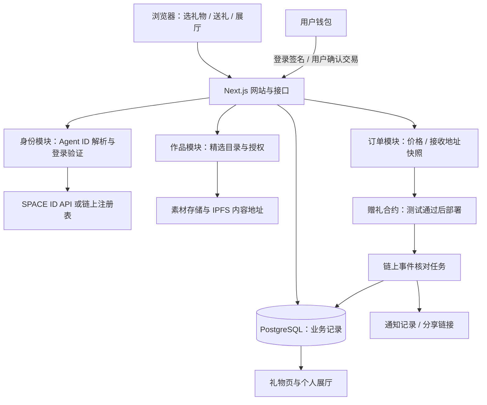

# 技术架构

## 给项目发起人的说明

先建一个应用，同时提供网页和后台。数据库记住订单与作品；区块链证明实际赠送；图片存储保存艺术作品；后台任务核对到账并准备通知。演示阶段可以先模拟外部环节，真实交易只有在验证接通后才启用。

## 目标系统（除已注明部分外均待实现）

## 技术选择

| 部分 | 初始方案 | 目的 / 当前状态 |
| --- | --- | --- |
| 网站与后台 | Next.js App Router + TypeScript + React | 同一个项目管理页面和接口；已建接口骨架 |
| 业务规则 | src/domain 独立模块 | 便于真实存储和演示存储替换；已实现小部分 |
| 数据库 | PostgreSQL，后续确定托管服务 | 用户、作品、订单、礼物、任务；尚未接入 |
| 数据访问 | 仓储接口，数据库阶段再选驱动/迁移工具 | 演示阶段仅进程内临时记录 |
| 钱包连接 | 接入方式待 Agentic Wallet 能力验证 | 不把 CLI 登录当成第三方网站登录 SDK |
| 登录 | 服务器挑战 + 钱包控制权证明 + 会话 | 普通钱包可评估 SIWE；特殊签名方式单独适配 |
| 名字解析 | SPACE ID Agent ID 官方 API / 注册表 | 官方能力已找到，代码尚未接入 |
| 链与合约 | BSC 候选；Solidity + OpenZeppelin + Foundry 候选 | 先验证 NFT 接收和签名，再确认链 |
| 素材 | 私有源文件存储 + 经授权发布的 IPFS 版本 | IPFS 需 pin 与备份，链上记录内容地址 |
| 异步核对 | 数据库 outbox + 定时执行器 | 初期不引入独立消息队列；尚未实现 |
| 质量检查 | TS 类型检查 + Node 测试 + Next 构建 + GitHub Actions | 本轮建立 |

## 五个模块的责任

1. **作品**：作品与艺术家、授权、上架状态、版本、价格。价格由服务器/合约校验，不能信任浏览器传入金额。
2. **身份**：名字解析、证明钱包控制权、登录会话；收礼人可未注册。记录链 ID 和最终地址，不能只存名字。
3. **订单**：保存购买意图、价格和地址快照、幂等请求；与赠礼结果分离。
4. **链上赠送**：用户确认、发交易、追踪事件。只凭交易哈希或前端成功弹窗不能宣称送达。
5. **展示与通知**：礼物详情、展厅、隐藏偏好、分享卡、用户自愿开启的通知。隐藏只作用于平台展示。

## 交易路径：待验证的候选

优先评估用户直接调用赠礼合约，在一笔交易内支付与铸造到接收地址；若所选钱包不能完成此路径，再比较替代方案，并记录成本与托管边界。暂不决定收款币种或平台代签方案。合约需校验有效作品、价格、库存和订单唯一标识，后端独立核验收款及 NFT 事件。

## 最先验证的技术问题

- 第三方网站怎样连接这个 Agentic Wallet，并获取可验证的登录签名？
- `.ai` 实际对应哪个钱包地址、哪条链，NFT 是否能接收及正常展示？
- 用户能否发起测试合约调用，完成预期购买流程？
- 不可转让 NFT 与钱包、浏览器的展示是否兼容？是否允许持有人销毁？

身份域名查询可用，不代表这些问题已完成验证；遇到不支持时先记录证据并调整方案，不要求用户交出私钥。

## 信任与部署边界

作品与网页由平台运营；资产所有权与赠送结果由合约和链记录。不能因为使用钱包就宣称全系统去中心化。真实部署需 HTTPS、数据库备份、会话保护、入口限流、监控及分离的测试/生产环境。托管商未定；本轮仅本地运行和私有仓库，不上线收款。
